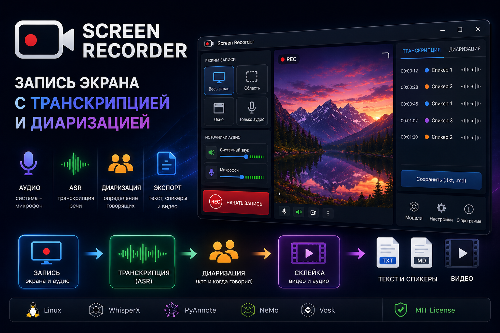

# Screen Recorder 🎥 — Запись экрана с транскрипцией и диаризацией

> Полнофункциональное десктопное приложение для записи экрана в Linux с автоматическим распознаванием речи (ASR) и определением говорящих. Создано для ежедневных стендапов, рабочих встреч, вебинаров, лекций и всего, что нужно сохранить не только в видео, но и в тексте с указанием кто и когда говорил.

**Автор:** Freekazoid — [Telegram](https://t.me/Ifreekazoid)
**Исходный код:** [GitHub](https://github.com/Freekazoid/recordingScreen)
**Лицензия:** MIT
**Версия:** 3.2.194

---

## 🦀 Ветка v4 (Rust)

Ветка `rewrite/v4` — переписывание приложения на Rust с нативным интерфейсом
egui. Python-реализация ниже относится к legacy 3.x.

### Сборка и запуск

```bash
cargo build --workspace
cargo run -p screenrecorder-app
```

Приложение состоит из двух процессов:

- **фоновый сервис** — запись, аудио, очередь, история и трей;
- **окно интерфейса** — только отображение состояния и команды.

Окно при старте само запускает сервис и подключается к нему через
Unix-сокет. Закрытие окна не останавливает запись: сервис продолжает
работать, а вернуть окно можно из трея. Для запуска только сервиса:

```bash
cargo run -p screenrecorder-app -- --daemon
```

### Окно на Wayland

Если в системе доступен X11 (в сессии GNOME/KDE это XWayland), окно
интерфейса по умолчанию запускается через него. Причина: в `winit`/`eframe`
на Wayland окно может навсегда перестать перерисовываться, если compositor
задержал frame callback (например, окно долго было закрыто другим окном).
Процесс и сервис при этом живы, запись идёт, но вкладки не реагируют до
закрытия и повторного открытия окна. X11 не использует frame callback'и,
поэтому этой проблемы там нет.

Захват экрана при этом остаётся нативным: сервис по-прежнему использует
ScreenCast-портал Wayland. Принудительно выбрать бэкенд окна можно
переменной:

```bash
SCREENRECORDER_UI_BACKEND=wayland cargo run -p screenrecorder-app
SCREENRECORDER_UI_BACKEND=x11 cargo run -p screenrecorder-app
```

Без переменной выбирается X11 при наличии рабочего X-сервера, иначе
Wayland. Выбранный бэкенд пишется в `app.log` строкой `бэкенд окна`.

### Логи

Окно и сервис пишут общий файл:

```bash
~/.local/share/screenrecorder/logs/app.log
```

Смотреть в реальном времени:

```bash
tail -f ~/.local/share/screenrecorder/logs/app.log
```

В лог попадают запуск, подключение окна, старт/остановка записи, preflight,
уровни mic/system, экспорт, распознавание, ошибки и состояние сервиса раз в
минуту. `daemon.log` остаётся для stderr/аварийных сообщений. Путь к логу
показывает `screenrecorder --diagnose`.

Собрать логи, диагностику, `ps`, `wpctl` и `xrandr` одним архивом:

```bash
./scripts/collect-logs.sh
```

### Настройки 3.x

При первом запуске v4, если файла v4 ещё нет, приложение ищет
`settings.json` 3.x рядом с программой и в XDG-каталоге данных. Переносятся
формат, качество, аудиорежим, диаризация, спикеры, пути к моделям и
результатам. Старый файл не удаляется; источник миграции пишется в лог.

Автозапуска при входе в систему нет: сервис поднимается при запуске окна и
живёт в трее до «Выхода».

`screenrecorder-app` при запуске ищет рядом с собой:

- `screenrecorder-ml` — ASR на whisper-rs;
- `screenrecorder-diarize` — диаризация sherpa-onnx;
- `screenrecorder-nemo` — альтернативная диаризация NeMo Sortformer.

Если отдельного `screenrecorder-ml` нет, приложение использует встроенный
режим `--ml-worker`. Диаризация всегда запускается отдельным процессом,
потому что whisper.cpp и sherpa-onnx конфликтуют в одном адресном
пространстве.

### GPU (опционально)

ASR может работать на CUDA-GPU. По умолчанию собирается CPU-воркер; GPU
включается отдельной сборкой:

```bash
./scripts/build_gpu_worker.sh
```

Скрипт собирает `screenrecorder-ml` с feature `cuda` и кладёт его рядом с
`screenrecorder`. После `cargo build --workspace` (CPU-воркер) скрипт нужно
запустить повторно. В настройках выберите **auto**: если GPU доступен, воркер
использует CUDA, иначе CPU. При ошибке инициализации CUDA в режиме `auto`
воркер автоматически повторяет распознавание на CPU; в прогресс-баре
показывается `GPU` или `CPU`. Явный режим `gpu` без CUDA-сборки завершается
понятной ошибкой.

### Качество ASR и микрофон

- Перед Whisper работает отдельный Silero VAD: тишина и шум не отправляются
  в модель, поэтому исчезают галлюцинации «Thank you» и «Продолжение
  следует».
- Язык `auto` определяется по первым ~30 секундам речи и фиксируется на
  весь файл; при неуверенности используется язык системы (`LANG`).
- Тихий микрофон нормализуется перед распознаванием; при экспорте
  применяется адаптивное усиление, highpass и dynaudnorm, чтобы голос был
  слышен в миксе.
- Диагностика и источники: `docs/09-asr-quality.md`.

### Модели

В v4 доступны только:
- ASR — whisper-rs `large-v3-turbo`;
- диаризация — sherpa-onnx или NeMo Sortformer;
- VAD — Silero для whisper.cpp.

Vosk и PyAnnote в v4 не поддерживаются; упоминания ниже относятся к legacy 3.x.

Модели скачиваются из раздела «Настройки → Модели»:

- `whisper` — GGML `large-v3-turbo`;
- `vad` — Silero VAD для whisper.cpp;
- `diarization` — сегментация + speaker embeddings для sherpa-onnx;
- `nemo` — NeMo Sortformer (Nemotron-3 diarization, ONNX).

Файлы лежат в каталоге данных приложения (`models/<id>/`). После скачивания
проверяется SHA256.

### Что уже работает в v4

- X11 и Wayland: весь экран, область, окно, только аудио.
- Раздельные дорожки `system.wav` и `mic.wav`; системный звук —
  с monitor-портов PipeWire (`stream.capture.sink=true`).
- Сегментированная запись по 60 секунд и склейка после остановки/падения.
- Манифест сессии, восстановление незавершённых записей, журнал `capture.log`.
- Preflight-проверка микрофона и системного звука.
- ASR whisper-rs с VAD, таймкодами, прогрессом, отменой и экспортом
  TXT/MD/SRT/VTT/JSON.
- Копии транскриптов сохраняются рядом с экспортированным видео.
- Channel-aware транскрипция system/mic; диаризация sherpa-onnx или NeMo
  с метками `спикер_1…спикер_n`.
- SQLite-история сессий и задач; удаление записи из истории.
- Трей с отдельными режимами записи и горячими клавишами Ctrl+Shift+1…5,
  системные уведомления. Крестик закрывает только окно: сервис, запись и
  трей продолжают работать. В доке/панели задач окна больше нет — остаётся
  только значок в трее. Полное завершение — через «Выход» в трее.
- На вкладке «Запись» вместо текстового журнала — только текущее состояние
  с подробным описанием. Для ML показывается процент и кнопка отмены.
- Сохранение доступа ScreenCast через restore-token (без повторного диалога).

### Ограничения текущего среза

- Встроенного редактора транскрипта нет: TXT открывается внешним
  редактором. В истории доступно удаление записи.
- Очередь экспорта и распознавания работает в фоновом сервисе; при
  падении задачи `running → queued` восстанавливаются при следующем старте.
- Windows и macOS требуют отдельной проверки и упаковки.
- Legacy Python-код ещё не удалён: он остаётся справочной реализацией до
  завершения Rust-упаковки.

### Проверки

```bash
cargo fmt --all -- --check
cargo clippy --workspace --all-targets -- -D warnings
cargo test --workspace
```

Живые проверки, которым нужен реальный экран/звук:

```bash
# Эталонный клип и измерение A/V sync
./scripts/make_av_sync_clip.sh testdata/av-sync/av-sync-test.mp4
./scripts/check_av_sync.sh ~/Видео/ScreenRecorder/<запись>.mkv

# Ручной 30-минутный soak (X11 + ffmpeg)
cargo test -p screenrecorder-adapters records_x11_30_minutes -- --ignored --nocapture
```

Протокол A/V sync, требования к multi-monitor/HiDPI и форматы корпусов
WER/DER описаны в `docs/05-av-sync-test.md`, `docs/06-multi-monitor-hidpi.md`
и `docs/07-wer-der.md`.

---

## ✨ Возможности

### 🎬 Запись видео
- **Весь экран** — захват полного монитора через `mss` (20 FPS)
- **Область экрана** — интерактивное выделение области мышью (12 FPS)
- **Окно приложения** — выбор окна из списка с предпросмотром иконок, захват через Xlib
- **Только аудио** — запись без видео, только системный звук + микрофон

### 🎙 Запись аудио
- Одновременная запись **системного звука** (десктоп) и **микрофона**
- Поддержка PulseAudio и PipeWire на Linux, DirectShow/WASAPI на Windows
- Поддержка AVFoundation на macOS (микрофон из коробки; для системного звука нужно виртуальное устройство — например **BlackHole**)
- Автоматическое смешивание дорожек

### 🤖 Транскрипция речи (Speech-to-Text)
- **WhisperX** (`faster-whisper large-v3-turbo`, OpenAI) — рекомендуется, быстрое и точное распознавание
- **Vosk** — лёгкая офлайн-альтернатива (без GPU)
- Результат: `.txt` файл с текстом (опционально с таймкодами)

### 🗣 Диаризация (определение говорящих)
- **PyAnnote** (`pyannote/speaker-diarization-3.1`) — нейросетевая диаризация, нужен HF_TOKEN
- **NeMo Sortformer** (`nvidia/diar_sortformer_4spk-v1`) — до 4 спикеров, без токена
- Результат: `.md` файл с размеченными спикерами:
  ```
  **Спикер 1** [00:12 - 00:28]: текст...
  **Спикер 2** [00:28 - 00:45]: текст...
  ```

### ⚙️ Пост-обработка
- Склейка видео + аудио в один файл (mp4, mkv, webm, avi, mov, flv)
- Настраиваемое качество видео (CRF 18/23/28/35)
- Режимы аудиодорожки: оригинал, сжатие (AAC 128k), удаление
- Асинхронная обработка в фоновом процессе — интерфейс не зависает

### 🧠 Управление моделями
- Скачивание моделей WhisperX, PyAnnote, NeMo Sortformer и Vosk прямо из интерфейса
- Визуальные индикаторы прогресса, подсказки «ⓘ» с описанием каждой модели
- HF_TOKEN нужен только PyAnnote

---

## 🚀 Быстрый старт

### Запуск из исходников (разработка)

```bash
# Клонирование
git clone https://github.com/Freekazoid/recordingScreen
cd recordingScreen

# Всё окружение одной командой (без sudo):
# CPython 3.14 в .python/, venv, зависимости и _tkinter с fontconfig
bash scripts/setup_env.sh

# Запуск
.venv/bin/python src/main.py
```

> ⚠️ **Важно про шрифты:** bundled-сборки Python (python-build-standalone, conda)
> поставляют Tk без fontconfig — кириллица рендерится на ~70% шире.
> `scripts/setup_env.sh` автоматически собирает `_tkinter` против системного
> Tcl/Tk 8.6 (Xft/fontconfig). `build_AppImage.sh` проверяет это и отклоняет
> сборку с кривым шрифтом. После переноса проекта просто запустите скрипт заново.

### Сборка standalone-билдов

```bash
# Linux AppImage
./build_AppImage.sh

# macOS .app + .zip + .dmg
./build_macOS.sh

# Windows .exe (кросс-компиляция через Docker)
./build_windows.sh
```

### 📦 GitHub-релизы: сборка AppImage из частей

Сборки с CUDA-поддержкой (GPU) весят **больше 2 ГБ**, поэтому GitHub не
загружает их одним файлом — лимит одного файла в релизе **2 ГБ**. Workflow
автоматически делит AppImage командой `split -b 1500M` на части:

```
ScreenRecorder_vbuild-48.AppImage.part-aa   (1.46 GB)
ScreenRecorder_vbuild-48.AppImage.part-ab   (1.46 GB)
ScreenRecorder_vbuild-48.AppImage.part-ac   (872 MB)
```

Чтобы восстановить целый AppImage, скачайте **все** части (одну и ту же
версию/сборку — не перемешивайте!), объедините их **по алфавиту** (`aa`, `ab`,
`ac`, …) и сделайте исполняемым:

```bash
cat ./*.AppImage.part-* > ScreenRecorder_vbuild-48.AppImage
chmod +x ScreenRecorder_vbuild-48.AppImage
```

Удобный вариант той же команды (части в порядке следования):

```bash
cat \
  ScreenRecorder_vbuild-48.AppImage.part-aa \
  ScreenRecorder_vbuild-48.AppImage.part-ab \
  ScreenRecorder_vbuild-48.AppImage.part-ac \
  > ScreenRecorder_vbuild-48.AppImage
```

**Проверка контрольной суммы.** Рядом с каждой частью GitHub показывает её
`sha256`. Сверьте хеш собранного файла:

```bash
sha256sum ScreenRecorder_vbuild-48.AppImage
```

Он должен совпасть с указанным в релизе (либо с тем, что выведется при сборке).
Размер собранного файла должен быть равен сумме частей (≈ их общий размер).

> 💡 **Совет:** альтернатива — собрать AppImage локально одним файлом через
> `./build_AppImage.sh`. Такой файл можно скачать целиком, без склейки частей.
> Для обычного (CPU) использования размером <2 ГБ GitHub-релиз отдаёт один файл.

### Требования для сборки AppImage (Linux x86_64)

**Системные пакеты** (проверьте перед сборкой):

| Пакет | Назначение | Обязателен |
|---|---|---|
| `libtcl8.6`, `libtk8.6` | Компиляция `_tkinter` с fontconfig | ✅ да |
| `gcc`, `make` | Компиляция `_tkinter` | ✅ да |
| `curl`, `dpkg` | Скачивание CPython и dev-заголовков | ✅ да |
| `ffmpeg` | Кодирование видео/аудио при запуске | ⚠️ или `bin/linux/ffmpeg` |
| `xdg-desktop-portal`, `pipewire`, `gstreamer1.0-pipewire` | Запись экрана на Wayland | ⚠️ для Wayland |

```bash
sudo apt install libtcl8.6 libtk8.6 gcc make curl ffmpeg \
  xdg-desktop-portal pipewire gstreamer1.0-pipewire
```

**Окружение проекта** — создаётся автоматически скриптом (без sudo):

```bash
bash scripts/setup_env.sh    # CPython 3.14 → .python/, venv, зависимости, _tkinter
```

| Каталог | Что внутри | Размер |
|---|---|---|
| `.python/` | CPython 3.14 (python-build-standalone) | ~113 МБ |
| `.venv/` | Зависимости из `requirements.txt` (torch CPU) | ~2 ГБ |
| `.sdk/` | Dev-заголовки Tcl/Tk/X11 для сборки `_tkinter` | ~60 МБ |
| `tools/` | `appimagetool` для упаковки AppImage | ~10 МБ |

**Порядок сборки с нуля:**

```bash
git clone https://github.com/Freekazoid/recordingScreen
cd recordingScreen
bash scripts/setup_env.sh     # окружение + проверка шрифтов
./build_AppImage.sh           # → output/ScreenRecorder_v<версия>.AppImage
```

> 💡 После **переноса проекта** в другую директорию просто повторно запустите
> `bash scripts/setup_env.sh` — он пересоздаст venv под новый путь.
> Скрипт идемпотентен: готовые шаги пропускаются.

### Переменные окружения для сборки

| Переменная | Описание |
|---|---|
| `APP_VERSION` | Переопределить версию |
| `FFMPEG_LINUX_DIR` | Путь к встроенным ffmpeg бинарникам для Linux |
| `FFMPEG_MACOS_DIR` | Путь к встроенным ffmpeg бинарникам для macOS |
| `FFMPEG_WINDOWS_DIR` | Путь к встроенным ffmpeg бинарникам для Windows |
| `MACOS_TARGET_ARCH` | Архитектура macOS (`arm64`, `x86_64`, `universal2`) |
| `MACOS_SIGN_IDENTITY` | Идентификатор подписи кода macOS |
| `CREATE_DMG=1` | Создать .dmg образ на macOS |
| `CLEANUP_DOCKER_IMAGE` | Удалить Docker образ после сборки Windows |

---

## 🧰 Стек технологий

| Слой | Технология |
|---|---|
| Язык | Python 3.14 (python-build-standalone; CI — 3.11) |
| UI | Tkinter / ttk |
| Захват видео | `mss`, `PIL.ImageGrab`, X11 / ScreenCast-портал (Wayland) |
| Кодирование видео | OpenCV (`cv2.VideoWriter`, XVID) |
| Захват аудио | `ffmpeg` (subprocess), `pw-record` / `pw-link` |
| Склейка A/V | `ffmpeg` (subprocess) |
| Распознавание речи | WhisperX (`faster-whisper large-v3-turbo`), Vosk |
| Диаризация | PyAnnote (`diarize`), NeMo Sortformer (`nemo`) |
| Управление моделями | `huggingface_hub` |
| Системный трей | `pystray` |
| Сборка | PyInstaller (AppImage / .app / .exe) |

---

## 📁 Структура проекта

```
src/
├── main.py                         # Точка входа (+ ensure_portal_identity)
├── gui_window.py                   # Главное окно (Tkinter), логика записи
├── full_screen.py                  # Захват полного экрана
├── area_screen.py                  # Захват области экрана (Wayland/X11)
├── program_screen.py               # Захват окна приложения
├── program_screen_wayland.py       # Запись окна/экрана через портал на Wayland
├── audio_recorder.py               # Запись аудио (PulseAudio/PipeWire/WASAPI)
├── audio_transcriber_service.py    # Транскрипция + диаризация
├── merge_save.py                   # Склейка видео и аудио
├── model_manager.py                # Менеджер загрузки моделей
├── background_tasks.py             # Фоновые процессы (multiprocessing)
├── settings_manager.py             # Единая точка настроек (дефолты из default_settings.json)
├── app_paths.py                    # Пути данных (dev/AppImage)
├── portal_identity.py              # App-id портала для Wayland (cgroup-scope)
├── screencast_frame.py             # Долгоживущая ScreenCast-сессия для снимков области
├── ffmpeg_locator.py               # Поиск ffmpeg в системе
├── tray_icon.py                    # Иконка в системном трее
└── default_settings.json           # Заводские настройки по умолчанию

scripts/
├── setup_env.sh                    # Bootstrap окружения (одной командой)
├── build_tkinter.sh                # Сборка _tkinter против Tcl/Tk 8.6 (fontconfig)
├── fetch_tk_dev_headers.sh         # Dev-заголовки из deb-пакетов (без sudo)
├── test_core_modules.py            # Быстрые тесты ядра (без GUI/D-Bus)
├── test_settings.py                # Тесты подсистемы настроек
└── test_fresh_install.py           # Регресс-тест «свежей установки» (AppImage)

build_AppImage.sh                   # Сборка Linux AppImage
```

---

## 📌 Примечания

- Приложение разработано в первую очередь для **Linux**; поддержка Windows — частичная
- Для работы транскрипции и диаризации требуются модели машинного обучения (скачиваются из интерфейса)
- Для доступа к моделям HF-токен нужен только **PyAnnote**; WhisperX, NeMo Sortformer и Vosk скачиваются без него
- Весь интерфейс — на **русском языке**
- Для записи окон в **Wayland** необходимы системные пакеты: `python3-gi`, `xdg-desktop-portal`, `pipewire`, `gstreamer1.0-pipewire`, а также набор плагинов `gstreamer1.0-plugins-good` / `gstreamer1.0-plugins-bad`

---

## ⚙️ Настройки (settings.json)

Заводские значения хранятся в `src/default_settings.json` и поставляются
внутри приложения. Пользовательский `settings.json` создаётся автоматически
при первом запуске — его можно править вручную.

> 📦 **В AppImage** маунт read-only, поэтому данные хранятся в
> `~/.local/share/ScreenRecorder/`: `settings.json`, модели, `.hf_token`.
> В dev-режиме конфиг лежит в корне проекта. Пути к моделям и результатам
> переопределяются в настройках приложения.
>
> 🔄 Устаревшие значения переносятся автоматически (`whisper` → `whisperx`,
> `sherpa` → `nemo`, длинные подписи качества/звука — в короткие).

| Ключ | Описание | Где используется |
|---|---|---|
| `transcription_engine` | Движок распознавания: `whisperx` или `vosk` | Транскрипция и постобработка |
| `compute_device` | Устройство для распознавания: `auto`, `gpu`, `cpu` | Транскрибатор |
| `diarization_method` | Метод спикеров: `none`, `diarize`, `nemo` | Диаризация и постобработка |
| `enable_transcription` | Включить распознавание текста | Постобработка, ручная транскрипция |
| `enable_diarization` | Включить разметку спикеров | Постобработка, ручная транскрипция |
| `debug_mode` | Сохранять промежуточные файлы | Постобработка (очистка временных файлов) |
| `expected_speakers` | Ожидаемое число спикеров | Диаризация/кластеризация |
| `min_speakers` | Минимум спикеров | Диаризация/кластеризация |
| `max_speakers` | Максимум спикеров | Диаризация/кластеризация |
| `output_format` | Формат финального видео: `mp4`, `mkv`, `webm`, `avi`, `mov`, `flv` | Экспорт видео |
| `video_quality` | Качество/CRF (строка из UI) | Экспорт видео |
| `audio_track_mode` | Режим аудио: оригинал/сжатие/удалить | Экспорт видео |
| `models_dir` | Директория хранения моделей | Загрузка/использование моделей |
| `output_dir` | Директория для результатов | Финальные видео/тексты |

> 📁 Если `models_dir` или `output_dir` пусты, приложение использует каталог,
> где расположен запущенный файл программы (полный путь вычисляется при
> старте). Туда же пишутся и логи (каталог `logs/`). Как только пользователь
> задаст свой путь в настройках — он сохранится и будет использоваться.
> Поведение одинаково на Linux, Windows и macOS: для macOS это папка,
> содержащая `.app`-бандл (а не `Contents/MacOS` внутри него). Если каталог
> программы недоступен для записи (AppImage squashfs read-only, macOS
> `/Applications`, Windows `Program Files`), пустые значения указывают на
> `~/.local/share/ScreenRecorder` (см. примечание выше).

Примечание: если редактируете `settings.json` вручную, перезапустите приложение.
