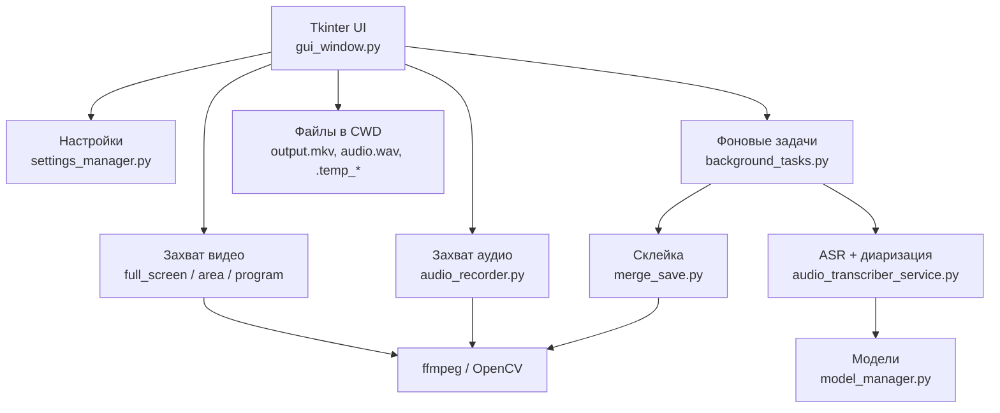
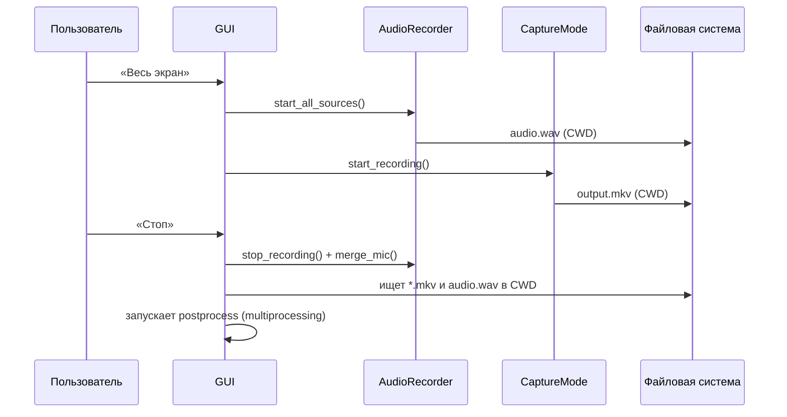
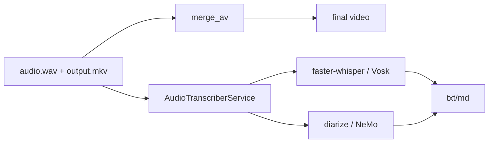
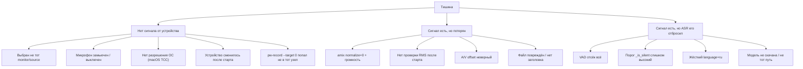
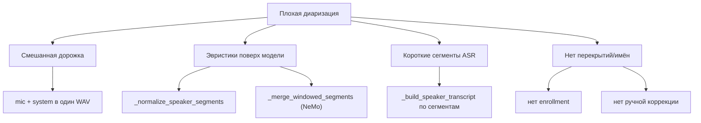

# Discovery — Screen Recorder 4.0

> **Статус:** черновик, требует валидации интервью и репродукцией дефектов
> **Дата:** 2026-11-04
> **Автор анализа:** команда проекта (PM/analyst/architect)
> **Связанные документы:** `PROJECT_MEMORY.md`, `roadmap.md`,
> `02-architecture-v2.md`, `03-adr.md`, `04-test-plan.md`

---

## 1. Зачем этот документ

MVP работает, но пользовательские проблемы (тишина, спикеры, права, разные
ОС) — это не «мелкие баги», а следствие архитектурных решений:

- запись и обработка завязаны на текущий каталог;
- микрофон и системный звук смешиваются до распознавания;
- нет проверки фактического сигнала;
- нет устойчивой модели задач;
- UI и бизнес-логика живут в одном файле.

Discovery нужен, чтобы **не переписывать вслепую**: подтвердить причины,
зафиксировать метрики и выбрать минимальный набор изменений, который даёт
максимальный эффект.

---

## 2. Метод

1. Статический разбор репозитория (структура, модули, сборка, CI).
2. Трассировка пользовательских сценариев по коду.
3. Формулировка гипотез причин (5 Whys / дерево отказов).
4. План репродукции на Linux/Windows/macOS.
5. Интервью с пользователями (следующий шаг).
6. Baseline-метрики на эталонных записях.

**Ограничение:** на текущем шаге не менялись системные настройки и не
запускались деструктивные эксперименты. Всё, что требует прав/порталов,
описано как план проверки.

---

## 3. Пользователи и jobs-to-be-done

### 3.1 Персоны

| Персона | Контекст | Критерий успеха |
|---|---|---|
| **Организатор стендапа** | 5–10 человек, созвон в Linux, микрофон + наушники | Запись без пустот, текст с именами, быстрый экспорт |
| **Лектор** | 60–90 минут, тихая речь, возможен шум | Полный текст без потерь, таймкоды, спикер = лектор |
| **Интервьюер** | 2 человека, вопросы/ответы | Чёткое разделение «я / собеседник», возможность переименовать |
| **Пользователь Windows** | Ноутбук, нет admin | Установка и запись без танцев с драйверами |
| **Пользователь macOS** | MacBook, созвон | Системный звук без BlackHole (или понятная инструкция) |
| **Сопровождающий** | Собирает релизы | Воспроизводимая сборка, логи, понятные ошибки |

### 3.2 JTBD (jobs-to-be-done)

- «Когда я записываю встречу, я хочу быть уверен, что звук пишется, чтобы не
  обнаружить тишину после часа разговора».
- «Когда я получаю расшифровку, я хочу видеть, кто говорил, чтобы не
  перечитывать весь текст и не угадывать».
- «Когда я запускаю приложение на другой машине, я хочу, чтобы оно просто
  работало, а не требовало прав администратора».
- «Когда обработка падает, я хочу продолжить с места падения, а не начинать
  заново».

---

## 4. AS-IS: архитектура и поток

### 4.1 Контейнеры

### 4.2 Поток записи (упрощённо)

**Критично:** UI ищет результат через `os.listdir('.')`
(`gui_window.py:1403-1411`). Это работает только если CWD совпал с местом
записи. Из ярлыка/меню CWD может быть другим.

### 4.3 Поток обработки

### 4.4 Технологический стек

| Слой | Факт |
|---|---|
| UI | Tkinter/ttk, один класс `AppWindow` |
| Захват видео | `mss`, `PIL.ImageGrab`, Xlib, portal/PipeWire, OpenCV `VideoWriter` (XVID) |
| Захват аудио | ffmpeg subprocess; `pactl`/`pw-dump`/`pw-record`; WASAPI/DirectShow; AVFoundation |
| Склейка | ffmpeg subprocess |
| ASR | faster-whisper (`WhisperModel`), Vosk |
| Диаризация | пакет `diarize` (PyAnnote), NeMo Sortformer |
| Модели | huggingface_hub, ручной `model_manager` |
| Сборка | PyInstaller: Linux/macOS — onedir, Windows — onefile; AppImage/EXE/APP |
| CI | `compileall` + сборка, без тестов |

### 4.5 Что уже сделано хорошо

Это важно сохранить при переписывании:

- Понятный пользовательский сценарий и русский интерфейс.
- Работающий fallback-цепочки для Wayland (portal → pipewire → wf-recorder).
- Аккуратные `app_paths` для frozen-сборок (пусть и не везде используются).
- Разделение фоновой обработки в отдельный процесс.
- Понятные сообщения в ряде мест (macOS-микрофон, Wayland-зависимости).
- Наличие регрессионных скриптов `scripts/test_*.py` и ручных сценариев.

---

## 5. Проблемные области

### 5.1 P0 — «Тишина» в записи

#### Симптомы

- Файл есть, длительность есть, звука нет.
- Транскрипция: пустой текст, «Аудио не содержит различимого сигнала»,
  либо «WhisperX не распознал речь».
- На одной машине работает, на другой — нет; после смены наушников — нет.

#### Дерево причин

#### Доказательства в коде

| Факт | Файл/строки | Почему важно |
|---|---|---|
| Успех записи = `process_main is not None` | `gui_window.py:1731-1733` | Процесс может работать, но писать тишину |
| Нет проверки уровня после старта | `audio_recorder.py:970-1118` | Нет обратной связи пользователю |
| `_is_silent` по RMS `5e-4` | `audio_transcriber_service.py:459-464` | Тихая речь может быть отброшена |
| `amix` + `volume=12dB` | `audio_recorder.py:1005-1008, 1111-1114` | Клиппинг/дисбаланс уровней |
| `_merge_mic` + `3dB` | `audio_recorder.py:815-820` | Другая громкость, чем при старте |
| `language="ru"` | `audio_transcriber_service.py:1078-1086` | Другой язык → мусор/пусто |
| `audio_silence_duration` только для Windows/macOS | `audio_recorder.py:1066-1080` | На Linux offset = None |
| UI ищет `audio.wav` в CWD | `gui_window.py:1403-1411` | Может взять чужой/старый файл |

#### Гипотезы (проверить)

- **H1.** В большинстве случаев тишина — это неверно выбранный источник
  (monitor vs sink) или замьюченный микрофон, а не баг ASR.
- **H2.** На Linux `pw-record --target 0` не гарантирует нужный узел; нужен
  явный target по имени/ID.
- **H3.** После смены устройства вывода ffmpeg продолжает писать старый
  monitor, который стал тихим.
- **H4.** Смешивание дорожек ухудшает и уровень, и диаризацию; раздельные
  дорожки решают обе проблемы.
- **H5.** Часть «тишины» — ложное срабатывание `_is_silent` на тихой речи.

#### Что делать (направление)

1. Preflight-проба 1 с на каждое устройство + индикатор уровня до старта.
2. Писать системную и микрофонную дорожки раздельно.
3. После старта через 2–3 с проверять RMS каждой дорожки; если тихо —
   предупреждать и предлагать выбрать другое устройство.
4. Не блокировать всю транскрипцию, если одна дорожка тихая.
5. Порог тишины — адаптивный (по фоновому шуму), а не константа.
6. Язык — auto/явный, не хардкод.

---

### 5.2 P1 — Диаризация спикеров

#### Симптомы

- Один спикер = два; два = один.
- Метки меняются между фразами.
- На смешанной дорожке диаризация почти бесполезна.
- После переименования спикера в тексте всё равно «Спикер 1».

#### Дерево причин

#### Доказательства в коде

| Факт | Файл/строки |
|---|---|
| Микширование mic+system в один файл | `audio_recorder.py:804-840` |
| Эвристическое сглаживание меток | `audio_transcriber_service.py:1223-1324` |
| Пословное назначение по перекрытию | `audio_transcriber_service.py:1151-1155` |
| Транскрипция каждого сегмента отдельно | `audio_transcriber_service.py:1373-1422` |
| Окна NeMo + сопоставление меток | `audio_transcriber_service.py:306-435` |
| Vosk отключает диаризацию | `background_tasks.py:291-297` |

#### Гипотезы

- **H6.** Раздельные дорожки дадут больше прироста, чем смена модели
  диаризации: локальный/удалённый — сильнейший признак.
- **H7.** Эвристическое сглаживание иногда ухудшает результат; его нужно
  сделать opt-in и логировать изменения.
- **H8.** Транскрипция целыми фразами (а не сегментами диаризации) снизит WER
  и стабилизирует метки.

#### Что делать

1. Channel-aware: system → удалённые, mic → локальные; merge по времени.
2. pyannote community-1/3.1 с `exclusive`, ограничениями спикеров и
   overlap-политикой.
3. Сначала ASR по всей дорожке, потом назначение спикеров словам/фразам.
4. Enrollment и ручное переименование.
5. Метрика DER на корпусе, а не «на слух».

---

### 5.3 P2 — Права и пути

#### Симптомы

- «Permission denied» при запуске из ярлыка.
- Результаты не там, где ожидает пользователь.
- Приложение не находит `output.mkv`, потому что CWD другой.
- На AppImage/`/Applications`/`Program Files` нельзя писать рядом.

#### Доказательства

| Факт | Файл/строки |
|---|---|
| Запись в CWD | `full_screen.py:34`, `area_screen.py:498`, `program_screen.py:422`, `program_screen_wayland.py:643` |
| Поиск результата в CWD | `gui_window.py:1403-1411` |
| Временные файлы в CWD | `gui_window.py:1436-1452`, `background_tasks.py:362-372` |
| Очистка temp в CWD | `main.py:30-41` |
| Попытка писать `bin/` рядом с приложением | `ffmpeg_locator.py:104-125` |
| Хороший, но неиспользуемый `app_paths` | `app_paths.py` |

#### Гипотезы

- **H9.** Большая часть «проблем с правами» — это CWD и запись в каталог
  установки, а не отсутствие прав ОС.
- **H10.** Проверка `os.access` недостаточна (сетевые диски, ACL, read-only
  mount); нужна реальная запись пробного файла.
- **H11.** Выбранный пользователем `output_dir` может быть недоступен; нужен
  fallback с уведомлением, а не молчаливый сбой.

#### Что делать

1. Единый `PathService` (Rust `dirs`/`directories`) + write-probe.
2. Все артефакты — в `session_dir`, а не в CWD.
3. `output_dir` проверять до старта; fallback на `~/Videos/ScreenRecorder`.
4. Запрет записи в install dir; portable-режим — только явно.
5. Тест-страж в CI: «ни one файл вне data/cache/temp».

---

### 5.4 P3 — Кроссплатформенный запуск

#### Симптомы

- Linux работает, Windows/macOS — частично.
- На Wayland портал отказывает без app-id.
- macOS не пишет системный звук без BlackHole.
- Сборка огромная, CI не запускает приложение.

#### Доказательства

| Факт | Файл |
|---|---|
| `systemd-run` для app-id | `portal_identity.py:75-91` |
| Windows onefile + большой CUDA payload | `build_windows.sh`, `.github/workflows/release.yml`; Linux/macOS уже onedir |
| Только `compileall` в CI | `.github/workflows/release.yml:42-46` |
| Разные версии Python | `pyproject.toml` (>=3.10), dev 3.14, CI 3.11 |
| CUDA в базовой сборке | `.github/workflows/release.yml:33-37` |
| macOS без ScreenCaptureKit | `audio_recorder.py:200-383` |

#### Гипотезы

- **H12.** Onedir + CPU-default + отдельные модели уменьшат размер и число
  проблем запуска.
- **H13.** Нативные адаптеры (WGC, ScreenCaptureKit, PipeWire) дадут
  стабильность, но требуют per-OS тестов; ffmpeg-fallback обязателен.
- **H14.** Без CI E2E кроссплатформенность останется «на честном слове».

---

### 5.5 P4 — Сопровождаемость

- `gui_window.py` 2008 строк: UI + ФС + настройки + запуск процессов.
- `audio_transcriber_service.py` 1852 строки: 4 разных пайплайна в одном классе.
- Плоские импорты и `--hidden-import` — хрупкая сборка.
- Нет истории/восстановления.
- Настройки без версии схемы.
- Чужой `release.yaml` в корне.
- `main.py:30-41` использует `shutil.rmtree`, но `shutil` не импортирован;
  `NameError` глотается `except Exception`, поэтому очистка temp не работает.
  (В рабочем дереве есть незакоммиченные правки `main.py` — их не трогали.)
- В ветке `faster-whisper` (`full_transcribe → _transcribe_whisperx`) не
  вызывается `cleanup()` для `temp_dir`/`audio_temp_dir` — временные каталоги
  остаются после обработки.

**Вывод:** нужен архитектурный рефакторинг, а не только точечные патчи.

---

## 6. 5 Whys (сводно)

### Тишина

1. Почему нет текста? — ASR получил тишину/пустой сигнал.
2. Почему сигнал пустой? — Записалась не та дорожка или микрофон был выключен.
3. Почему не заметили? — Нет проверки фактического уровня после старта.
4. Почему проверки нет? — Захват считается успешным по факту запуска процесса.
5. Почему так спроектировано? — Нет слоя preflight/диагностики и раздельных
   дорожек; всё смешано в одном файле.

### Спикеры

1. Почему путаются? — Диаризация работает на смешанной дорожке.
2. Почему смешанной? — Запись mic+system микшируется до ASR.
3. Почему микшируется? — MVP оптимизирован под один итоговый файл.
4. Почему это проблема? — Теряется признак «локальный/удалённый».
5. Почему не разделено? — Нет доменной модели дорожек и channel-aware пайплайна.

### Права

1. Почему отказ? — Запись идёт в CWD/каталог установки.
2. Почему туда? — Пути фиксированные, исторически «рядом с программой».
3. Почему не data dir? — `app_paths` появился позже и не применён везде.
4. Почему не проверяется? — Нет write-probe и валидации output dir.
5. Почему не тестируется? — Нет E2E на чистой установке.

---

## 7. Ограничения и допущения

### Ограничения

- Не менять систему (AGENTS.md): никаких `systemctl`, `gsettings`, пакетов,
  порталов.
- Приложение должно работать без root/admin.
- Локальная обработка по умолчанию; облако — только с согласия.
- Linux — основная платформа; Windows/macOS — цель паритета, но не ценой
  Linux.
- Модели и лицензии нужно проверять отдельно.

### Принятые решения (2026-11-04)

- **Полный rewrite** в версии 4.0; legacy 3.2.194 сохраняется.
- Ядро — **Rust**; UI — **нативный Rust (egui/eframe)**; Go + Wails —
  альтернатива.
- ML — **Python 3.12 sidecar**; общение по JSON-RPC.
- **Offline + опциональное облако**; Linux-first (X11+Wayland); CPU +
  optional GPU pack.

### Допущения (требуют подтверждения)

- Пользователи готовы к смене UI на нативный Rust (egui), если
  функциональность сохранится.
- Раздельные дорожки допустимы и не ломают сценарий «один файл на выходе».
- CPU-качества достаточно для большинства; GPU — опция.
- Linux-first MVP (X11+Wayland) укладывается в 14–18 недель при одном
  разработчике (при условии ограниченного scope).
- Rust-крейты покрывают нужные capture/audio API или есть ffmpeg-fallback.

---

## 8. Метрики и baseline

| Метрика | Как измерять | Baseline (заполнить) |
|---|---|---|
| Доля записей с валидным звуком | RMS > порога на хотя бы одной дорожке | TBD |
| Доля «ложной тишины» | Валидная тихая запись, помеченная тишиной | TBD |
| WER | Эталонные расшифровки, `jiwer` | TBD |
| DER | `pyannote.metrics`, RTTM | TBD |
| Время обработки | RTF = processing_time / audio_duration | TBD |
| Crash-free sessions | Логи/телеметрия (opt-in) | TBD |
| Ошибки прав | Счётчик fail в preflight | TBD |
| Старт приложения | cold start до окна | TBD |

**План:** собрать 5 эталонных записей (2/3/4 спикера, тихая речь, шум,
перекрытия), вручную разметить RTTM и тексты, прогнать текущую версию.

---

## 9. План Discovery (следующие шаги)

| Шаг | Действие | Выход |
|---|---|---|
| 1 | 5–8 интервью (15–20 мин) | Цитаты, приоритеты, сценарии |
| 2 | Репродукция на Linux X11 | Логи, причины, шаги |
| 3 | Репродукция на Linux Wayland | Портал, устройства, ошибки |
| 4 | Репродукция на Windows VM | WASAPI, права, установка |
| 5 | Репродукция на macOS VM | TCC, BlackHole, ScreenCaptureKit |
| 6 | Сбор эталонного корпуса | WER/DER baseline |
| 7 | Утверждение scope | Gate G0 |

### Вопросы для интервью

1. Расскажите последний случай, когда запись получилась пустой. Что было до?
2. Как вы понимаете, что звук пишется? Смотрите ли на индикатор?
3. Сколько спикеров обычно? Бывают ли перекрытия?
4. Что важнее: точность текста или скорость?
5. Готовы ли вы устанавливать виртуальное аудиоустройство на macOS?
6. Что должно быть в экспорте: txt, md, srt, docx?
7. Что раздражает в текущем интерфейсе больше всего?
8. Какой у вас компьютер/ОС/микрофон?

---

## 10. Риски Discovery

| Риск | Mitigation |
|---|---|
| Гипотезы не подтвердятся | Сначала репродукция, потом архитектура |
| Пользователи не придут на интервью | 3–5 коротких звонков + асинхронная форма |
| Нет эталонных записей | Синтетика (TTS/записи с телефона) + публичные датасеты |
| Linux-специфика искажает выводы | Отдельная матрица по ОС, не обобщать |
| Слишком широкий scope | MVP-срез: запись + текст + спикеры + права |

---

## 11. Что не входит в Discovery

- Реализация кода.
- Изменение системных настроек.
- Выбор конкретной модели навсегда (это ADR после замеров).
- Маркетинг/монетизация.

---

## 12. Итог

Проблемы MVP — системные:

1. **Нет раздельных дорожек** → тишина и плохая диаризация.
2. **Нет preflight** → пользователь узнаёт о проблеме после записи.
3. **Пути завязаны на CWD** → права и «файлы не там».
4. **Нет job-модели** → обработку нельзя продолжить.
5. **UI и логика связаны** → страшно менять.

Целевая архитектура (см. `02-architecture-v2.md`) лечит это на уровне
структуры, а не отдельными заплатками.
