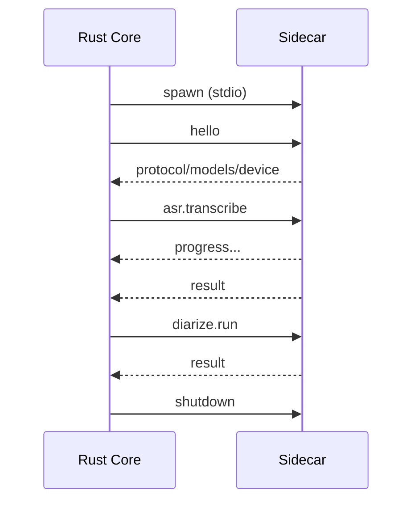
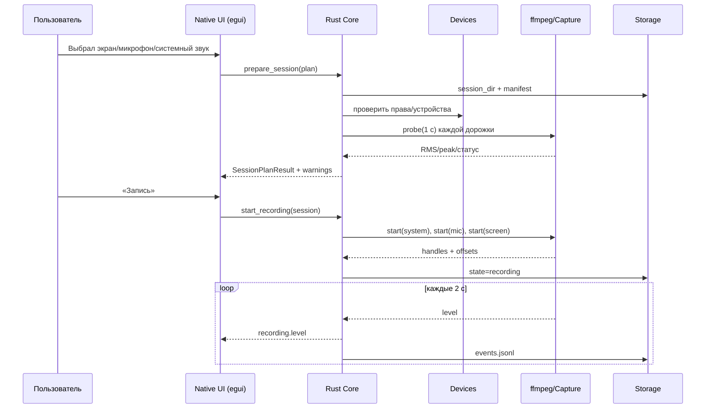
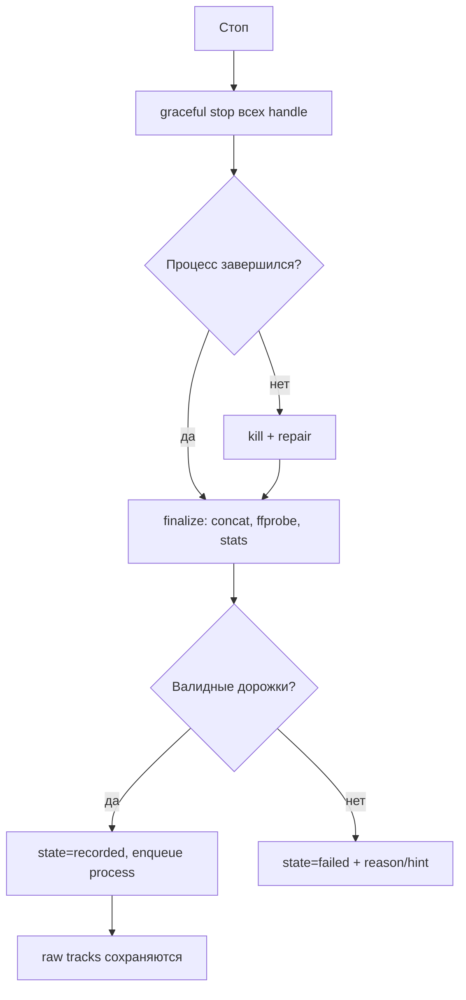
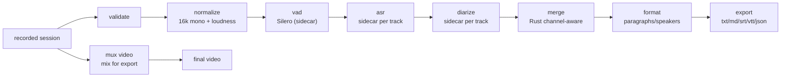
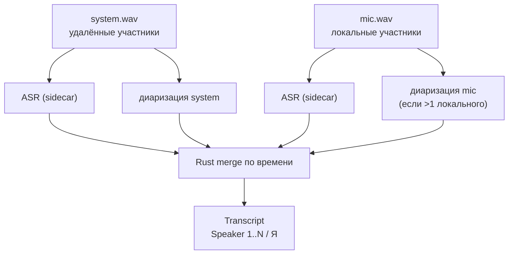

# Целевая архитектура Screen Recorder 4.0 (rewrite)

> **Статус:** Accepted (стек: Rust + нативный UI egui + Python sidecar;
> Go + Wails — альтернатива)
> **Дата:** 2026-11-04
> **Связанные документы:** `PROJECT_MEMORY.md`, `roadmap.md`,
> `01-discovery.md`, `03-adr.md`, `04-test-plan.md`

---

## 1. Цели и не-цели

### Цели

1. **Надёжная запись:** пользователь не может потерять час встречи из-за
   тишины, смены устройства или падения приложения.
2. **Понятная транскрипция:** текст соответствует речи, язык определяется,
   тихая речь не отбрасывается.
3. **Устойчивая диаризация:** локальные и удалённые участники разделяются
   архитектурно, а не эвристикой.
4. **Кроссплатформенность:** Linux, Windows, macOS — без root/admin.
5. **Скорость и отзывчивость:** Rust-ядро и нативный UI (egui); ML не
   блокирует UI.
6. **Ремонтопригодность:** слои, контракты, тесты; новый разработчик
   понимает поток за день.
7. **Предсказуемая сборка:** воспроизводимые зависимости, подпись,
   понятные ошибки.

### Не-цели MVP

- Облачная платформа/аккаунты.
- Realtime-транскрипция.
- Совместная работа.
- Мобильные приложения.
- Микросервисы и серверная инфраструктура.
- Собственный медиа-движок вместо ffmpeg.

---

## 2. Принятые решения

| Решение | Значение |
|---|---|
| Стратегия | Полный rewrite, версия **4.0**; legacy 3.2.194 сохраняется |
| Ядро | **Rust** (рекомендация); Go + Wails — альтернатива |
| UI | **egui/eframe** (MIT/Apache-2.0) |
| ML | **Python 3.12 sidecar** (faster-whisper, pyannote, Vosk) |
| Облако | Offline по умолчанию + опциональный cloud-адаптер |
| ОС | Linux-first (X11 + Wayland в первом инкременте), затем Windows/macOS |
| GPU | CPU default + опциональный GPU-пак |
| Медиа | ffmpeg/ffprobe |
| Хранение | SQLite (WAL) + файловые артефакты |

---

## 3. Почему Rust + нативный UI (egui), а не Go + Wails

| Критерий | Rust + egui | Go + Wails |
|---|---|---|
| Захват экрана/звука | Зрелые крейты `windows`, `objc2`, `ashpd`, `pipewire` | Больше cgo/внешних утилит |
| Производительность | Без GC, предсказуемые задержки | GC, но обычно достаточно |
| Размер | Малый бинарник, без WebView | Малый бинарник + WebView ОС |
| UI-экосистема | egui/eframe, `egui_extras`, `rfd`, `tray-icon` | Wails, React/TS |
| Кривая обучения | Выше | Ниже |
| Риск для этого проекта | Ниже в capture/audio | Выше в native-интеграциях |

**Решение:** Rust + **egui/eframe** как основной путь. Если команда сильнее
в Go, архитектура не меняется: Go-ядро + Wails UI + тот же Python sidecar;
capture-адаптеры могут вызывать ffmpeg/нативные хелперы. Ключевые границы
(контракты, sidecar, SQLite, раздельные дорожки) сохраняются.

**Почему не Tauri:** пользователь выбрал нативный UI; WebView добавляет
зависимости (WebKitGTK/WebView2), CSP и ограничения по доступу.
**Почему не Slint:** GPLv3/коммерческая лицензия конфликтует с MIT.
**Почему не iced:** меньше готовых компонентов для таблиц/редактора;
можно рассмотреть как замену UI-слоя позже.

---

## 4. Архитектурный стиль

**Полиглотный модульный монолит.**

- Rust-ядро — гексагональная архитектура (домен, порты, адаптеры).
- Нативный UI (egui/eframe) — отдельный слой представления; вызывает
  `AppController` и подписывается на события.
- Python sidecar — изолированный ML-процесс; общается по JSON-RPC.
- ffmpeg — внешний медиа-инструмент, управляемый Rust.
- SQLite — локальное хранилище состояния.

```
┌────────────────────────────────────────────────────────────┐
│ Native UI (egui/eframe)                                     │
│  Record | History | Transcript | Settings | Diagnostics     │
└───────────────────────────┬────────────────────────────────┘
                            │ AppController + events
┌───────────────────────────▼────────────────────────────────┐
│ Rust Core                                                   │
│  domain ← application (ports/use cases) ← adapters          │
│  capture | media | storage | platform | ipc | cli           │
└───────────────┬──────────────────────────────┬──────────────┘
                │ ffmpeg/ffprobe               │ JSON-RPC stdio
┌───────────────▼──────────────┐  ┌────────────▼──────────────┐
│ ffmpeg (encode/mux/probe)    │  │ Python ML sidecar          │
│                              │  │ faster-whisper / pyannote  │
└──────────────────────────────┘  └────────────────────────────┘
```

### Правило зависимостей

```
domain  ←  application  ←  adapters / platform / ipc / cli
                              ↑
                         ui (egui)
```

- `domain` не знает про UI, ffmpeg, SQLite, Python.
- `application` знает порты и сценарии.
- `adapters` реализуют порты.
- `ui` вызывает use cases и подписывается на события.
- `bootstrap` собирает зависимости.

Нарушения ловятся `cargo`-модулями и code review; при необходимости —
`import`-подобный линтер/`cargo-modules`.

---

## 5. Структура репозитория

```
recordingScreen/
  Cargo.toml                    # workspace
  crates/
    domain/                     # чистый Rust: Session, Track, Transcript, Job
    application/                # порты, use cases, state machines
    adapters/
      capture/                  # x11, wayland, windows, macos, ffmpeg
      media/                    # ffmpeg runner, probe, loudness, mux
      storage/                  # SQLite, filesystem artifacts
      ipc/                      # sidecar client/supervisor
      platform/                 # paths, permissions, tray, updater
    cli/                        # --diagnose, headless
    app/                        # composition root + AppController
    ui/                         # egui/eframe views, widgets, i18n
  ml-sidecar/                   # Python 3.12
    ml_sidecar/
      __main__.py
      server.py                 # JSON-RPC stdio
      asr/
      diarization/
      models/
      contracts/
    pyproject.toml
    tests/
  contracts/                    # JSON Schema + golden examples
    session.schema.json
    track.schema.json
    transcript.schema.json
    job.schema.json
    rpc.schema.json
  packaging/
    app/                        # cargo-packager config, icons, entitlements
    sidecar/                    # PyInstaller spec
    linux/                      # .desktop, AppImage notes
    windows/                    # installer config
    macos/                      # Info.plist, notarization
  tests/
    fixtures/                   # аудио/видео, RTTM, тексты
    e2e/
  docs/
```

### Почему так

- Rust-ядро можно тестировать без UI и без Python.
- Sidecar можно запускать отдельно (`ml-sidecar transcribe ...`) и тестировать
  как обычный CLI.
- Контракты — единый источник правды для Rust/Python.
- UI вызывает только `AppController`, не трогает адаптеры/ФС напрямую.

---

## 6. Rust-ядро: слои и модули

### 6.1 `domain`

Чистые структуры и правила:

```rust
pub struct Session {
    pub id: SessionId,
    pub title: String,
    pub created_at: DateTime<Utc>,
    pub started_at: Option<DateTime<Utc>>,
    pub ended_at: Option<DateTime<Utc>>,
    pub state: SessionState,
    pub output_dir: PathBuf,
    pub app_version: String,
    pub os: OsKind,
    pub manifest_version: u32,
}

pub enum SessionState {
    Created,
    Preparing,
    Ready,
    Recording,
    Finalizing,
    Recorded,
    Processing,
    Transcribed,
    Exported,
    Done,
    Interrupted,
    Failed,
    Cancelled,
}

pub enum TrackKind { Screen, System, Mic, Mix }

pub struct Track {
    pub id: TrackId,
    pub session_id: SessionId,
    pub kind: TrackKind,
    pub device_id: Option<String>,
    pub path: PathBuf,
    pub codec: String,
    pub sample_rate: Option<u32>,
    pub channels: Option<u16>,
    pub duration_ms: Option<u64>,
    pub start_offset_ms: i64,
    pub stats: TrackStats,
    pub status: TrackStatus,
}

pub struct TrackStats {
    pub rms_dbfs: f32,
    pub peak_dbfs: f32,
    pub silence_ratio: f32,
    pub clipping_ratio: f32,
    pub speech_ratio: Option<f32>,
}
```

Домен не делает I/O. Все проверки/переходы — методы/сервисы домена.

### 6.2 `application`

Порты (traits) и use cases:

```rust
#[async_trait]
pub trait ScreenCapture: Send + Sync {
    fn capabilities(&self) -> CaptureCapabilities;
    fn list_sources(&self) -> Result<Vec<ScreenSource>>;
    async fn probe(&self, source: &ScreenSource, seconds: f32) -> Result<ProbeResult>;
    async fn start(&self, request: CaptureRequest) -> Result<CaptureHandle>;
    async fn stop(&self, handle: CaptureHandle) -> Result<CaptureResult>;
}

#[async_trait]
pub trait AudioCapture: Send + Sync {
    fn list_devices(&self) -> Result<Vec<AudioDevice>>;
    async fn probe(&self, device: &AudioDevice, seconds: f32) -> Result<AudioProbe>;
    async fn start(&self, request: AudioCaptureRequest) -> Result<AudioCaptureHandle>;
    async fn stop(&self, handle: AudioCaptureHandle) -> Result<AudioCaptureResult>;
}

#[async_trait]
pub trait Asr: Send + Sync {
    async fn transcribe(&self, request: TranscriptionRequest) -> Result<Transcript>;
}

#[async_trait]
pub trait Diarization: Send + Sync {
    async fn diarize(&self, request: DiarizationRequest) -> Result<Vec<SpeakerTurn>>;
}

#[async_trait]
pub trait SessionRepository: Send + Sync {
    async fn save(&self, session: &Session) -> Result<()>;
    async fn get(&self, id: &SessionId) -> Result<Option<Session>>;
    async fn list_recent(&self, limit: usize) -> Result<Vec<Session>>;
}

#[async_trait]
pub trait JobQueue: Send + Sync {
    async fn enqueue(&self, job: Job) -> Result<()>;
    async fn claim(&self) -> Result<Option<Job>>;
    async fn complete(&self, id: &JobId, result: JobResult) -> Result<()>;
    async fn fail(&self, id: &JobId, error: JobError, retryable: bool) -> Result<()>;
}

pub trait Clock: Send + Sync {
    fn now(&self) -> DateTime<Utc>;
    fn monotonic_ms(&self) -> u64;
}

pub trait PathService: Send + Sync {
    fn data_dir(&self) -> &Path;
    fn cache_dir(&self) -> &Path;
    fn log_dir(&self) -> &Path;
    fn temp_dir(&self) -> &Path;
    fn default_output_dir(&self) -> &Path;
    fn ensure_writable(&self, path: &Path) -> WriteCheck;
}
```

Use cases:

- `PrepareSession` — создать сессию, проверить права/устройства/диск.
- `StartRecording` — запустить дорожки, сохранить offsets.
- `StopRecording` — финализировать, валидировать, поставить job.
- `ProcessSession` — оркестрация шагов.
- `TranscribeTrack` / `DiarizeTrack` — вызов sidecar.
- `MergeTranscript` — channel-aware слияние (в Rust).
- `ExportSession` — ffmpeg mux + текстовые форматы.
- `RecoverInterrupted` — восстановление при старте.

### 6.3 `adapters`

| Адаптер | Ответственность |
|---|---|
| `capture::linux_x11` | `x11grab`/`xcap`, область/окно |
| `capture::linux_wayland` | `ashpd` portal + PipeWire; fallback `wf-recorder` |
| `capture::windows` | WGC/`ddagrab`; fallback `gdigrab` |
| `capture::macos` | ScreenCaptureKit/`avfoundation` |
| `capture::ffmpeg` | общий запуск/супервизор ffmpeg |
| `audio::pipewire` | source/monitor, явный target |
| `audio::wasapi` | loopback + mic |
| `audio::coreaudio` | mic + tap/BlackHole |
| `media::ffmpeg` | probe, encode, mux, loudness |
| `storage::sqlite` | репозитории, миграции |
| `ipc::sidecar` | JSON-RPC клиент, health, restart |
| `platform::paths` | data/cache/logs/temp/output |
| `platform::permissions` | TCC/portal/WASAPI checks |
| `platform::tray` | иконка/меню |
| `platform::updater` | самообновление (cargo-packager/self-update) |

---

## 7. Нативный UI (egui/eframe)

### 7.1 Стек

- **egui/eframe** (MIT/Apache-2.0) — нативный immediate-mode UI.
- `egui_extras` — таблицы, изображения, хелперы.
- `rfd` — нативные диалоги выбора файлов/папок.
- `tray-icon` — системный трей; `global-hotkey` — горячие клавиши.
- `egui-notify`/собственные toasts — уведомления.
- `rust-i18n`/`fluent` — русский по умолчанию, английский.
- `egui_kittest` — UI-тесты/снапшоты (где применимо).
- `AccessKit` — доступность (встроен в egui; проверить на целевых ОС).

### 7.2 `AppController` (пример)

UI не вызывает адаптеры напрямую; только методы контроллера:

```rust
impl AppController {
    pub async fn list_devices(&self) -> Result<DevicesDto, AppError>;
    pub async fn prepare_session(&self, plan: SessionPlanDto)
        -> Result<SessionPlanResultDto, AppError>;
    pub async fn start_recording(&self, session_id: SessionId) -> Result<(), AppError>;
    pub async fn stop_recording(&self, session_id: SessionId)
        -> Result<SessionSummaryDto, AppError>;
    pub async fn list_sessions(&self, limit: usize) -> Result<Vec<SessionSummaryDto>, AppError>;
    pub async fn process_session(&self, session_id: SessionId) -> Result<(), AppError>;
    pub async fn export_session(&self, request: ExportRequestDto)
        -> Result<ExportResultDto, AppError>;
    pub async fn get_transcript(&self, session_id: SessionId)
        -> Result<TranscriptDto, AppError>;
    pub async fn rename_speaker(&self, request: RenameSpeakerDto)
        -> Result<(), AppError>;
    pub async fn diagnostics(&self) -> Result<DiagnosticsDto, AppError>;
}
```

### 7.3 События

| Событие | Payload |
|---|---|
| `recording.state` | `{session_id, state, since}` |
| `recording.level` | `{track, rms_dbfs, peak_dbfs, ts}` |
| `job.progress` | `{job_id, step, percent, message}` |
| `job.log` | `{job_id, level, message}` |
| `device.changed` | `{kind, added, removed, default}` |
| `error` | `{code, user_message, hint}` |

UI получает события через `tokio::sync::broadcast`/`crossbeam`-канал и
вызывает `egui::Context::request_repaint()`; троттлинг уровня — 10 Гц.

### 7.4 Безопасность и границы

- UI не имеет произвольного доступа к shell/fs; только `AppController`.
- Пути валидируются в Rust; диалоги — через `rfd`.
- Никаких внешних скриптов/WebView/CSP — меньше поверхность атаки.
- Команды, меняющие состояние, идут через domain-правила.
- Секреты/токены в UI не показываются целиком.

### 7.5 Экраны

1. **Запись** — источники, устройства, уровни, preflight, таймер, диск.
2. **История** — сессии, статусы, повтор, папка, удаление.
3. **Транскрипт** — спикеры, переименование, split/merge, переход по времени.
4. **Настройки** — устройства, папки, язык, модели, GPU/CPU, cloud opt-in.
5. **Диагностика** — компоненты, отчёт, логи.

### 7.6 Ограничения egui

- Нет нативных виджетов «как в ОС»; внешний вид единый, но не
  platform-native. Для утилиты это приемлемо.
- Доступность (screen reader) слабее, чем у Qt/нативных тулкитов; проверять
  AccessKit на целевых ОС.
- Сложный rich-text редактор транскрипта придётся делать самим/на
  `egui_extras`; заложить время.
- Если UI-полировка станет блокером — UI-слой изолирован, можно заменить на
  iced/Slint (с проверкой лицензии) без изменения ядра.

---

## 8. Python ML sidecar

### 8.1 Ответственность

Sidecar делает только ML:

- загрузка/кэширование моделей;
- ASR с word timestamps;
- VAD;
- диаризация;
- эмбеддинги спикеров;
- возврат структурированного результата.

Sidecar **не**:
- выбирает пути пользователя;
- пишет в БД;
- управляет UI;
- решает, куда сохранять видео;
- читает настройки напрямую.

### 8.2 Протокол JSON-RPC 2.0 (stdio)

Каждое сообщение — одна строка JSON. Пример:

```json
{"jsonrpc":"2.0","id":1,"method":"hello","params":{"protocol":1}}
{"jsonrpc":"2.0","id":1,"result":{"protocol":1,"python":"3.12.8","device":"cpu","models":{"whisper":true,"pyannote":false}}}
```

Запрос ASR:

```json
{
  "jsonrpc": "2.0",
  "id": 2,
  "method": "asr.transcribe",
  "params": {
    "job_id": "job_01",
    "track_id": "trk_system",
    "audio_path": "/.../system.asr.wav",
    "language": "auto",
    "model": "large-v3-turbo",
    "word_timestamps": true,
    "vad": {"min_silence_ms": 400, "speech_pad_ms": 200}
  }
}
```

Прогресс:

```json
{"jsonrpc":"2.0","method":"progress","params":{"job_id":"job_01","step":"asr","percent":42}}
```

Результат:

```json
{
  "jsonrpc": "2.0",
  "id": 2,
  "result": {
    "language": "ru",
    "segments": [
      {"start_ms": 1200, "end_ms": 3400, "text": "Привет", "words": [
        {"text": "Привет", "start_ms": 1200, "end_ms": 1600, "confidence": 0.92}
      ]}
    ]
  }
}
```

Методы:

| Метод | Назначение |
|---|---|
| `hello` | handshake, версия протокола, доступные модели/устройство |
| `asr.transcribe` | распознавание дорожки |
| `diarize.run` | диаризация дорожки |
| `speaker.embed` | эмбеддинг для enrollment |
| `models.status` | что скачано/загружено |
| `models.download` | скачивание модели (прогресс) |
| `cancel` | отмена job |
| `shutdown` | корректное завершение |

### 8.3 Жизненный цикл



- Один долгоживущий процесс на приложение; модели кэшируются.
- Idle timeout (например, 10 мин) — выгрузка тяжёлых моделей.
- При падении — restart с backoff, job возвращается в очередь.
- stderr → лог-файл; stdout — только JSON-RPC.
- Таймауты на запрос; отмена через `cancel` + kill при необходимости.

### 8.4 Упаковка sidecar

- Python 3.12 + `uv.lock` для dev.
- PyInstaller **onedir** для релиза (быстрый старт, без распаковки).
- CPU-пакет: torch CPU + faster-whisper + pyannote + soundfile/numpy/scipy.
- GPU-пак: отдельный optional bundle; sidecar сообщает `device`.
- Модели — отдельно, скачиваются при первом запуске (или офлайн-пак).
- Подпись/нотаризация sidecar на macOS; на Windows — часть установщика.

### 8.5 Контракты

- JSON Schema в `contracts/`.
- Rust: `serde` + `schemars` (генерация/валидация).
- TS: генерация типов (`typeshare`/`ts-rs` или JSON Schema → types).
- Python: `pydantic`-модели + валидация.
- Golden examples в `contracts/examples/`; contract-тесты на обеих сторонах.
- `protocol_version` проверяется при `hello`; несовпадение — понятная ошибка.

---

## 9. Потоки

### 9.1 Подготовка и запись



**Ключевые решения:**

- аудиодорожки стартуют первыми, видео — после; сохраняем `start_offset_ms`;
- видео — сегменты по 60 с (fragmented MKV), чтобы падение не убило запись;
- `LevelMonitor` считает RMS/peak по PCM/`astats`, а не по факту наличия
  процесса;
- тихая дорожка > 3 с → предупреждение в UI, запись продолжается.

### 9.2 Остановка и восстановление



При старте приложения:

1. Найти сессии в `RECORDING`/`FINALIZING`.
2. Проверить сегменты; если данных достаточно — `INTERRUPTED → RECORDED`,
   поставить в очередь.
3. Если данных нет — `FAILED` с понятной причиной.
4. Никогда не удалять исходные дорожки автоматически.

### 9.3 Обработка



Каждый шаг:

- читает артефакты предыдущего;
- пишет новый артефакт атомарно (`.tmp` → `rename`);
- сохраняет `input_hash`, `config_hash`, `model_version`, `checksum`;
- при повторном запуске пропускается, если хэши совпали.

### 9.4 Channel-aware транскрипция



Правила merge:

1. Речь только в одной дорожке — берём её.
2. Речь в обеих одновременно:
   - приоритет system для удалённых, mic для локальных;
   - если текст разный — два сегмента с `overlap=True`;
   - если текст почти совпадает (эхо) — оставляем system, mic помечаем
     `echo=True` и не показываем.
3. Спикеры неймспейсятся: `sys:S1`, `mic:S1`; затем маппятся в имена.
4. Нет раздельных дорожек (старый файл/fallback) — обычная диаризация микса.

**Ограничения:**

- Без наушников mic ловит system → эхо. Решение: рекомендация наушников,
  опциональный AEC, дедупликация по тексту/корреляции.
- Некоторые приложения микшируют локальный mic в system → дубли. Решение:
  детект корреляции и fallback на mixed-режим.
- Разная громкость дорожек → нормализация для ASR, не для экспорта.

---

## 10. Аудиоархитектура

### 10.1 Дорожки

| Дорожка | Источник | Формат | Назначение |
|---|---|---|---|
| `system.wav` | monitor sink / WASAPI loopback / CoreAudio tap | 48 kHz, stereo, PCM 16/24 | Удалённые спикеры, музыка, демо |
| `mic-<id>.wav` | микрофон(ы) | 48 kHz, mono/stereo, PCM | Локальные спикеры |
| `mix.wav` | производная | 48 kHz, stereo | Экспорт, fallback, отладка |
| `screen.mkv` | экран/окно/область | H.264/VP9 + segments | Видео |

- Каждая дорожка — отдельный процесс/поток; падение одной не убивает другие.
- `mix.wav` — dual-mono: system L, mic R (удобно для диагностики).
- Никакого `amix` до ASR. Микс — только на экспорте.
- Уровни: peak/RMS каждые 2 с; в `events.jsonl`.

### 10.2 Предобработка для ASR

1. DC offset removal.
2. High-pass 80 Hz.
3. Loudness normalization к −16 LUFS (настраиваемо).
4. Опционально denoise (RNNoise) при низком SNR.
5. Resample 16 kHz mono.
6. VAD Silero; интервалы речи/пауз.

Экспорт видео использует оригинальные дорожки (или микс с ручными
уровнями), чтобы не терять качество.

### 10.3 Синхронизация

- Общий `t0` (monotonic) на все дорожки.
- Каждый адаптер пишет `first_pts_ms` и `started_at_monotonic_ms`.
- `start_offset_ms = first_pts_ms - t0`.
- При монтаже: `-itsoffset`/`adelay` по разнице.
- Проверка: хлопок/тон в начале тестовой записи; допуск ≤ 100 мс.

### 10.4 Политика тишины

| Условие | Действие |
|---|---|
| `rms_dbfs < -60` и `silence_ratio > 0.98` | дорожка `SILENT`; ASR пропускается; UI объясняет |
| низкий RMS, но речь есть | adaptive gain; ASR продолжается |
| все дорожки `SILENT` | сессия `FAILED` с диагностикой |
| одна дорожка `SILENT` | остальные обрабатываются; пометка |
| clipping > 1% | предупреждение; limiter для ASR-копии |

Порог не константа `5e-4`: считаем фон (первые 0.5 с), сравниваем с
уровнем речи, используем процентили.

---

## 11. ASR (sidecar)

### 11.1 Основной адаптер: faster-whisper

| Параметр | Значение | Комментарий |
|---|---|---|
| Модель | `large-v3-turbo` | `distil-large-v3` — опция |
| Устройство | CUDA при достаточной VRAM, иначе CPU | Авто + явный выбор |
| Compute type | `float16` GPU / `int8` CPU | |
| Язык | auto или явный | Убрать хардкод `ru` |
| VAD | Silero, `min_silence_duration_ms=300…500` | Не отбрасывать тихую речь |
| Word timestamps | да | Для диаризации/субтитров |
| Beam size | 5 | |
| Temperature | fallback 0.0…1.0 | Против зацикливаний |
| `condition_on_previous_text` | False для длинных файлов | Меньше галлюцинаций |
| Hotwords/initial prompt | из настроек | Имена, термины |

### 11.2 Чанкование

- Длинные файлы — окна 5–10 мин с перекрытием 1–2 с.
- Дедупликация слов на стыках по времени и тексту.
- Глобальные таймкоды сохраняются.
- Для каждого окна — свой prompt/condition.

### 11.3 WhisperX alignment (опция)

- Отдельный шаг `align` с wav2vec2-моделью для точных пословных таймкодов.
- Не путать с текущим названием: в 3.x «WhisperX» — это faster-whisper без
  отдельного alignment.
- В v4 адаптер называется `faster_whisper`, `whisperx_align` — отдельно.

### 11.4 Vosk

- Лёгкий offline-fallback для слабых машин.
- Диаризация не поддерживается; UI явно пишет «спикеры недоступны», не
  отключает молча.
- Не основной путь для русских встреч при наличии faster-whisper.

### 11.5 Облако (опция)

- `CloudAsr` — отдельный адаптер, выключен по умолчанию.
- Только по явному согласию; показывать, какие файлы уходят.
- Ключи — keyring; local fallback всегда доступен.

---

## 12. Диаризация (sidecar + Rust merge)

### 12.1 pyannote.audio

- `pyannote/speaker-diarization-community-1` (проверить актуальную
  версию/условия) или `speaker-diarization-3.1`.
- `num_speakers`, если известно; иначе `min/max`.
- `exclusive=True` для неперекрывающихся реплик; overlap — отдельно.
- Длинные файлы:
  - окна 10–15 мин с перекрытием 30 с;
  - эмбеддинги спикеров на окно;
  - глобальная агломеративная кластеризация;
  - маппинг локальных меток в глобальные.
- HF-токен — keyring; при отсутствии — сообщение и fallback на
  channel-only/эвристику.

### 12.2 Channel-aware (по умолчанию)

- Диаризация system — удалённые.
- Диаризация mic — только если несколько локальных.
- Один локальный — не тратим модель, помечаем «Я».
- Снижает DER и стоимость.

### 12.3 NeMo Sortformer (опция)

- До 4 спикеров; окна с сопоставлением меток.
- Альтернатива для машин без pyannote/токена.
- Не дефолт.

### 12.4 Имена спикеров

1. Enrollment 3–10 с (запись или sample из сессии).
2. Эмбеддинг → профиль в `data_dir/speakers/<id>.npy`.
3. Косинусное сходство; порог; имя.
4. Ручное переименование; сохраняется в сессии/профиле.
5. Цвета/иконки в UI.

### 12.5 Overlap и слияние

- Слова назначаются turn с максимальным перекрытием.
- При overlap — выбираем по уверенности/энергии, помечаем `overlap=True`.
- Фразы склеиваются по спикеру и паузе (0.8–1.2 с), а не по сегментам
  диаризации.
- Эвристическое сглаживание — opt-in, с логом изменений.

### 12.6 Метрики

- DER (collar 0.25 с, ignore overlap).
- Speaker count error.
- Speaker switch accuracy.
- Ручная оценка 5 записей.
- Корпус: 2/3/4 спикера, перекрытия, шум, тихая речь.

---

## 13. Кроссплатформенный захват

### 13.1 Матрица

| ОС | Видео (primary) | Видео (fallback) | Системный звук | Микрофон |
|---|---|---|---|---|
| Linux X11 | ffmpeg `x11grab` / `xcap` | `mss`-подобный захват | PulseAudio monitor / PipeWire | Pulse/PipeWire source |
| Linux Wayland | portal ScreenCast + PipeWire | `wf-recorder` (wlroots) | PipeWire monitor | PipeWire source |
| Windows 10/11 | WGC (нативный) или DXGI `ddagrab` | `gdigrab` | WASAPI loopback | WASAPI capture |
| macOS 12.3+ | ScreenCaptureKit | `avfoundation` | CoreAudio tap (14.2+) / BlackHole | AVFoundation |

### 13.2 Linux / Wayland

- Портал `org.freedesktop.portal.ScreenCast`; app-id обязателен для GNOME 46+.
- `.desktop` с `StartupWMClass` и app-id; Flatpak/`.desktop` даёт identity.
- Если портал отказал — сообщение и fallback на X11 (если доступен XWayland).
- PipeWire: явный target по `node.name`/`node.id`, не `--target 0`.
- Следить за сменой default sink; предупреждать.

### 13.3 Windows

- WGC (нативный) или DXGI Desktop Duplication (`ddagrab`) для качества.
- WASAPI loopback для system; WASAPI capture для mic.
- Без admin; per-user install.
- Смена устройства по умолчанию → событие/предупреждение.
- Подпись EXE/установщика (SmartScreen).

### 13.4 macOS

- ScreenCaptureKit для экрана и system audio (12.3+).
- CoreAudio tap (14.2+) для system без BlackHole; fallback BlackHole.
- TCC: `NSMicrophoneUsageDescription`, screen capture permission;
  `CGPreflightScreenCaptureAccess`/`CGRequestScreenCaptureAccess`
  (проверить актуальные ключи Info.plist).
- Подпись + notarization + hardened runtime.
- Данные — в Application Support, не в `.app`.

### 13.5 Общие правила

- Ленивые платформенные модули; `cfg(target_os)`.
- `Capabilities` сообщает UI, что доступно.
- Любой адаптер имеет `probe()` и `Unavailable(reason, hint)`.
- Fallback фиксируется в логе и манифесте.

---

## 14. Пути, права, данные

### 14.1 PathService

| Данные | Linux | Windows | macOS |
|---|---|---|---|
| Data | `~/.local/share/screenrecorder` | `%LOCALAPPDATA%\ScreenRecorder` | `~/Library/Application Support/ScreenRecorder` |
| Cache | `~/.cache/screenrecorder` | `%LOCALAPPDATA%\ScreenRecorder\cache` | `~/Library/Caches/ScreenRecorder` |
| Logs | `~/.local/state/screenrecorder/logs` | `%LOCALAPPDATA%\ScreenRecorder\logs` | `~/Library/Logs/ScreenRecorder` |
| Config | `~/.config/screenrecorder` | `%APPDATA%\ScreenRecorder` | `~/Library/Application Support/ScreenRecorder` |
| Output | `~/Videos/ScreenRecorder` | `%USERPROFILE%\Videos\ScreenRecorder` | `~/Movies/ScreenRecorder` |
| Temp | `$XDG_CACHE_HOME/screenrecorder/tmp` | `%TEMP%\ScreenRecorder` | `~/Library/Caches/ScreenRecorder/tmp` |

- Rust `dirs`/`directories` — единственный источник.
- `ensure_writable(path)`:
  1. создать каталог;
  2. записать `.write_probe`;
  3. `fsync`;
  4. удалить;
  5. проверить свободное место.
- Ошибка → `WriteCheck { ok: false, code, hint }`; UI предлагает другую папку
  или default.
- Portable-режим — только явно (`SCREENRECORDER_PORTABLE=1` или marker), с
  write-probe; без тихого fallback.

### 14.2 Структура сессии

```
<data>/recordings/<session-id>/
  manifest.json
  events.jsonl
  screen/
    segment-000.mkv
    segment-001.mkv
  audio/
    system.wav
    mic-<device-id>.wav
    mix.wav
  work/
    system.asr.wav
    mic.asr.wav
    vad.json
    asr.json
    diarization.json
    transcript.json
  exports/
    <name>.mp4
    <name>.txt
    <name>.srt
```

- `manifest.json` — атомарно, версия схемы, чек-суммы.
- `events.jsonl` — диагностика, без секретов.
- `work/` — TTL после успешного экспорта.
- Исходные дорожки — до явного удаления пользователем.

### 14.3 Права ОС

| ОС | Что нужно | Как проверяем | Сообщение |
|---|---|---|---|
| Linux | Pulse/PipeWire, портал, ffmpeg | `pactl`/`pw-dump`, портал | «Установите/включите…» |
| Windows | WASAPI, доступ к микрофону | Privacy settings | «Разрешите доступ…» |
| macOS | TCC mic/screen | `AVCaptureDevice`, `CGPreflight...` | «Системные настройки → Приватность…» |

- Никаких системных изменений со стороны приложения.
- Если без правки системы нельзя — инструкция, не падение.

---

## 15. Хранилище и job-модель

### 15.1 SQLite

```sql
CREATE TABLE sessions (
  id TEXT PRIMARY KEY,
  title TEXT NOT NULL,
  state TEXT NOT NULL,
  created_at TEXT NOT NULL,
  started_at TEXT,
  ended_at TEXT,
  output_dir TEXT,
  app_version TEXT,
  os_name TEXT,
  error_code TEXT,
  error_hint TEXT
);

CREATE TABLE tracks (
  id TEXT PRIMARY KEY,
  session_id TEXT NOT NULL REFERENCES sessions(id) ON DELETE CASCADE,
  kind TEXT NOT NULL,
  device_id TEXT,
  path TEXT NOT NULL,
  codec TEXT,
  sample_rate INTEGER,
  channels INTEGER,
  duration_ms INTEGER,
  start_offset_ms INTEGER,
  rms_dbfs REAL,
  peak_dbfs REAL,
  silence_ratio REAL,
  status TEXT NOT NULL
);

CREATE TABLE jobs (
  id TEXT PRIMARY KEY,
  session_id TEXT NOT NULL REFERENCES sessions(id) ON DELETE CASCADE,
  type TEXT NOT NULL,
  state TEXT NOT NULL,
  priority INTEGER NOT NULL DEFAULT 0,
  attempts INTEGER NOT NULL DEFAULT 0,
  last_error TEXT,
  created_at TEXT NOT NULL,
  updated_at TEXT NOT NULL
);

CREATE TABLE job_steps (
  id TEXT PRIMARY KEY,
  job_id TEXT NOT NULL REFERENCES jobs(id) ON DELETE CASCADE,
  name TEXT NOT NULL,
  state TEXT NOT NULL,
  artifact_path TEXT,
  checksum TEXT,
  started_at TEXT,
  finished_at TEXT,
  error TEXT
);

CREATE TABLE speakers (
  id TEXT PRIMARY KEY,
  session_id TEXT NOT NULL REFERENCES sessions(id) ON DELETE CASCADE,
  label TEXT NOT NULL,
  display_name TEXT,
  source TEXT NOT NULL,
  embedding_path TEXT
);

CREATE TABLE transcript_segments (
  id TEXT PRIMARY KEY,
  session_id TEXT NOT NULL REFERENCES sessions(id) ON DELETE CASCADE,
  track_id TEXT,
  start_ms INTEGER NOT NULL,
  end_ms INTEGER NOT NULL,
  text TEXT NOT NULL,
  speaker_id TEXT,
  confidence REAL,
  language TEXT,
  overlap INTEGER NOT NULL DEFAULT 0
);

CREATE TABLE schema_meta (key TEXT PRIMARY KEY, value TEXT NOT NULL);
```

- WAL, `foreign_keys=ON`, миграции по `schema_version`.
- Репозитории возвращают доменные объекты.
- Никаких бизнес-правил в SQL.

### 15.2 Очередь

- SQLite + Tokio worker; `claim()` — атомарный `UPDATE ... RETURNING`.
- Supervisor: worker умер → job в `queued` (retry count).
- Приоритеты: интерактивная транскрипция > экспорт > переобработка.
- Отмена: cooperative + kill после таймаута.

### 15.3 Восстановление

- На старте: `running → queued`, `recording → interrupted`.
- Проверка артефактов по чек-суммам; битые — пересоздать.
- UI: «Обработка была прервана, продолжаем…».
- Никаких тихих удалений.

---

## 16. Настройки, логи, секреты, ошибки

### 16.1 Настройки

- Rust `serde` + `schema_version`; JSON для пользователя.
- Поля: устройства, папки, язык, модели, compute device, cloud opt-in,
  тема, горячие клавиши.
- Атомарная запись; бэкап; блокировка.
- Никаких глобальных `DEFAULTS`; только `SettingsService`.

### 16.2 Логи

- `tracing` + JSON layer + человекочитаемый файл.
- Поля: `ts`, `level`, `event`, `session_id`, `job_id`, `track_id`, `step`,
  `duration_ms`, `error_code`, `hint`.
- Ротация; хранение 14 дней.
- Redaction: токены, пароли, чувствительные пути.
- Debug: подробные логи ffmpeg/sidecar, без секретов.

### 16.3 Секреты

- Rust `keyring` (GNOME Keyring/KWallet/Windows Credential Manager/macOS
  Keychain).
- Fallback: запрос токена на сессию, не plaintext.
- Миграция `.hf_token` из 3.x: прочитать, положить в keyring, предложить
  удалить; не удалять без согласия.
- В логах — `hf_token=***`.

### 16.4 Ошибки

```rust
#[derive(Debug, thiserror::Error)]
#[error("{code}: {user_message}")]
pub struct AppError {
    pub code: ErrorCode,
    pub user_message: String,
    pub hint: String,
    pub technical: Option<String>,
    pub retryable: bool,
}
```

UI показывает `user_message` + `hint`; технические детали — в «Подробнее» и
логах. Коды — для тестов/телеметрии.

---

## 17. Сборка и поставка

### 17.1 Зависимости

- Rust stable, `Cargo.lock` в репозитории.
- Python 3.12 + `uv.lock` для sidecar.
- ffmpeg/ffprobe — статическая сборка, bundled.
- Никакого Node/WebView: UI — нативный egui.

### 17.2 Упаковка

| ОС | Формат | Инструмент/особенности |
|---|---|---|
| Linux | AppImage + `.deb` | `cargo-packager`; AppImage с fallback `--appimage-extract-and-run`; `.desktop` с app-id |
| Windows | NSIS/MSI | `cargo-packager`; per-user, без admin; подпись |
| macOS | `.app` + `.dmg` | `cargo-packager`; universal2 или arch-specific; hardened runtime; notarization |

- Sidecar и ffmpeg — внешние бинарники в bundle.
- Модели — отдельно; первый запуск скачивает.
- GPU — optional pack, не в базовом установщике.
- Checksums (SHA256) в релизе.
- Альтернатива: `cargo-bundle` + `cargo-deb` + AppImage tooling, если
  `cargo-packager` не покрывает нужный формат.

### 17.3 CI/CD

```yaml
matrix: [ubuntu-22.04, windows-latest, macos-latest]
steps:
  - cargo fmt --check
  - cargo clippy -- -D warnings
  - cargo test
  - cargo deny check licenses
  - cargo audit
  - pytest ml-sidecar
  - cargo build --release
  - cargo packager --release
  - smoke: --diagnose
  - e2e (Linux/Windows, где возможно)
release:
  - sign/notarize
  - checksums
  - publish
```

- CI без GPU.
- E2E с реальным экраном — self-hosted/ручной; в CI — моки/синтетика.
- Кэш cargo/uv; фиксированные версии actions.

---

## 18. Производительность

| Метрика | Цель | Как проверяем |
|---|---|---|
| Cold start (UI) | ≤ 2 с | замер до окна |
| Idle RAM (core+UI) | ≤ 250 МБ | psutil/Activity Monitor |
| Запись 1080p30 | ≤ 8% одного ядра | профайлер |
| ASR large-v3-turbo int8 | ≤ 0.5 RTF на 8 ядрах | бенчмарк sidecar |
| Диаризация | ≤ 0.3 RTF | бенчмарк |
| Полный пайплайн 1 ч | ≤ 1.0 RTF | E2E |
| Размер core (без моделей/GPU) | ≤ 300 МБ | артефакт |
| Размер sidecar (CPU) | ≤ 600 МБ | артефакт |

- GPU: проверка VRAM до загрузки; fallback CPU.
- Модели не держать в памяти при RAM < 8 ГБ.
- Кэш эмбеддингов/ASR по хэшу.

---

## 19. Безопасность и приватность

- Локальная обработка по умолчанию; сеть только для моделей/обновлений/
  облака с согласия.
- TLS + проверка сертификатов; модели — по SHA256.
- Секреты — keyring; файлы 0600; каталоги 0700.
- Логи без токенов и полного текста транскрипта.
- UI вызывает только `AppController`; без произвольного shell/fs.
- License inventory: ffmpeg, egui/eframe (MIT/Apache), PyAnnote, NeMo, модели.
- Dependency scanning: `cargo audit`, `pip-audit` в CI.
- Предупреждение о записи участников — на усмотрение пользователя.

---

## 20. Наблюдаемость и поддержка

- `--diagnose`: версии, пути, устройства, права, бэкенды, ffmpeg, модели,
  sidecar; сохраняет отчёт.
- Crash report: zip с логами/манифестом/системой; медиа не включать.
- `events.jsonl` на сессию: устройства, смены, ошибки, уровни.
- Пользователь отправляет один файл.
- Телеметрия — только opt-in.

---

## 21. Переиспользование 3.x и миграция

### 21.1 Что переиспользуем

| Компонент 3.x | Как используем в 4.0 |
|---|---|
| `audio_transcriber_service` (алгоритмы) | Переносим ML-часть в sidecar, отвязываем от GUI/ФС |
| `faster-whisper`/PyAnnote/Vosk обёртки | Адаптеры sidecar |
| `model_manager` | Переписываем на Rust + sidecar download, сохраняем идеи |
| `merge_save`/ffmpeg-команды | Переносим в Rust media adapter |
| `wayland_portal`/`portal_identity` | Идеи и fallback-цепочки; Rust `ashpd`/portal |
| `settings_manager` + JSON | Схема/миграции; Rust serde |
| Экспорт/форматы/русские тексты | Сохраняем |
| Тестовые сценарии/фикстуры | Расширяем и переносим |

### 21.2 Что не переносим

- Tkinter UI и `gui_window.py`.
- CWD-пути, `os.listdir('.')`, `output.mkv`/`audio.wav`.
- Смешивание mic+system до ASR.
- Глобальные настройки/синглтоны.
- Windows onefile и огромный CUDA-образ.
- `systemd-run` как единственный путь app-id.

### 21.3 Миграция данных

- `settings.json` 3.x читается и мигрируется; старые значения сохраняются.
- Старые записи не перемещаются без согласия; «Импортировать папку» —
  отдельная функция.
- `.hf_token` → keyring с согласия.
- Никаких destructive-миграций без бэкапа.

### 21.4 Git

| Шаг | Действие |
|---|---|
| 1 | Тег `v3.2.194-legacy` |
| 2 | Ветка `rewrite/v4` |
| 3 | Версия `4.0.0-alpha.1` |
| 4 | `main` остаётся 3.x до Gate G7 |
| 5 | После релиза — merge и тег `v4.0.0` |

Историю не переписывать; force-push запрещён.

---

## 22. Критерии приёмки архитектуры

- [ ] Legacy 3.x доступен по тегу/ветке; новый код — в `rewrite/v4`.
- [ ] Rust-ядро не зависит от UI (egui) и Python.
- [ ] UI вызывает только `AppController`; без произвольного shell/fs.
- [ ] Python sidecar общается только по JSON-RPC и не знает про UI/БД.
- [ ] Все пути идут через `PathService`; тест-страж запрещает CWD/install.
- [ ] Запись создаёт раздельные дорожки и манифест.
- [ ] Обработка переживает kill -9 и продолжается.
- [ ] Тишина одной дорожки не блокирует остальные.
- [ ] Channel-aware диаризация работает на 2–4 спикерах.
- [ ] WER/DER измеряются в CI/артефактах.
- [ ] Сборка Rust + sidecar запускается на трёх ОС.
- [ ] Нет секретов в логах; токен в keyring.

---

## 23. Открытые решения

1. **UI-фреймворк:** egui/eframe (рекомендуется) или iced; Slint — только
   после проверки GPLv3/коммерческой лицензии.
2. Сроки/команда: 1 или 2 разработчика; дедлайн.
3. pyannote HF-токен/лицензия vs NeMo/Vosk как основной путь.
4. Python sidecar: подтверждаем, что ML остаётся на Python.
5. Нужен ли Flatpak/Snap в MVP.

Git-стратегия (`rewrite/v4`), Linux-first (X11+Wayland) и CPU+GPU pack уже
подтверждены.
